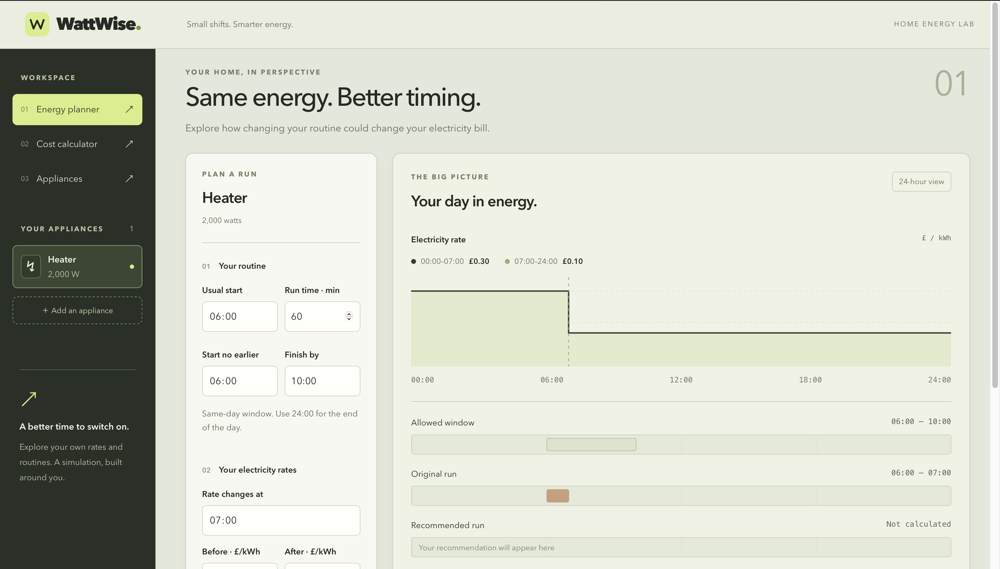
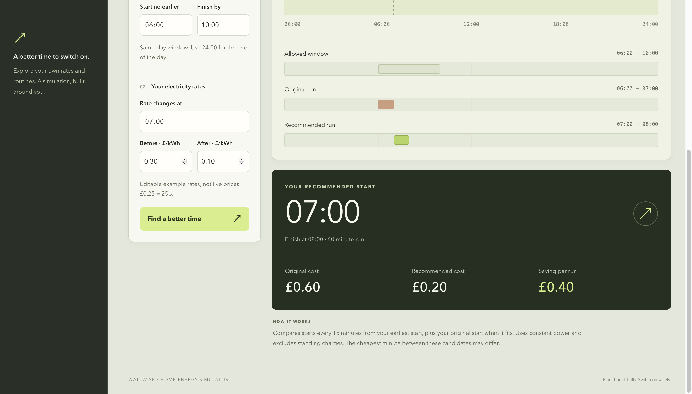

# WattWise

[](https://github.com/yaseen15x/wattwise/actions/workflows/ci.yml)

A home energy simulator that calculates appliance running costs and compares when to run them under different electricity tariffs.

Built with Java, Spring Boot, React, TypeScript and PostgreSQL.

## Live demo

**[Try WattWise](https://wattwise-frontend-rimw.onrender.com/)**

Add appliances, estimate their running costs, and compare schedules using editable electricity tariffs.

- No account required. Each browser session has its own appliance list.
- Sessions expire after two hours of inactivity. When a session expires or its cookie is cleared, its saved appliances are no longer accessible through the demo.
- The backend may take a little time to respond after inactivity.
- Electricity rates are user-entered examples, not live prices.

## Screenshots

### Energy planner



### Recommended running time



## Features

- Save, edit and delete appliances with their power ratings.
- Calculate energy consumption in kWh and estimated cost in GBP.
- Calculate household totals with a per-appliance breakdown through the API.
- Calculate costs for runs spanning different tariff periods.
- Recommend a start time within an allowed scheduling window.
- Visualise tariffs and compare original and recommended schedules.
- Keep saved appliances separate between anonymous visitor sessions.
- Persist appliance records and server-side sessions in PostgreSQL.

WattWise does not fetch live electricity prices or control appliances.

## Example

A 2,000 W heater running for one hour uses 2 kWh.

With a tariff of £0.30/kWh before 07:00 and £0.10/kWh afterwards:

| Schedule | Running time | Estimated cost |
|---|---|---|
| Original | 06:00–07:00 | £0.60 |
| Recommended | 07:00–08:00 | £0.20 |

For an allowed window of 06:00–10:00, moving the run saves £0.40 in this example while using the same amount of energy.

These are illustrative rates, not a claim about a particular electricity supplier.

## Tech stack

| Area | Technology |
|---|---|
| Backend | Java 21, Spring Boot, Spring Web MVC |
| Validation | Jakarta Bean Validation |
| Persistence | Spring Data JPA, Hibernate, PostgreSQL |
| Session storage | Spring Session JDBC |
| Database migrations | Flyway |
| Frontend | React, TypeScript, Vite |
| Testing | JUnit, MockMvc, Testcontainers |
| Local containers | Docker Compose, Nginx, PostgreSQL 17 |
| Continuous integration | GitHub Actions |
| Hosting | Render Static Site, Render Web Service, Neon PostgreSQL |

## Architecture

The React frontend sends requests to relative `/api/` paths. The request routing depends on how the application is running:

| Environment | Frontend delivery | API routing |
|---|---|---|
| Local development | Vite development server | Vite proxies `/api/` to Spring Boot |
| Local Docker | Nginx | Nginx proxies `/api/` to the backend container |
| Live demo | Render Static Site | Render rewrites `/api/` to the backend Web Service |

The Spring Boot backend separates HTTP controllers, request and response DTOs, calculation services and persistence.

Spring Data JPA handles appliance records. Flyway manages database migrations, and Hibernate validates entity mappings against the schema.

The live backend connects to Neon PostgreSQL. Local Docker uses a PostgreSQL container with a named volume.

### Visitor sessions

On the first saved-appliance request, the backend creates a session and assigns a visitor ID. Appliance queries and mutations are scoped to that visitor.

The browser receives a `WATTWISE_SESSION` cookie. The cookie is HTTP-only, uses `SameSite=Lax`, and is marked Secure in the HTTPS deployment.

Spring Session JDBC stores server-side sessions in PostgreSQL. An unexpired session can survive a backend restart when the browser retains its cookie.

This is anonymous session isolation, not account-based authentication. There is no login, account recovery or cross-device synchronisation.

## Run with Docker

### Requirements

- Git
- Docker with Docker Compose

Java and Node.js do not need to be installed locally for this option.

### 1. Clone the repository

```bash
git clone https://github.com/yaseen15x/wattwise.git
cd wattwise
```

### 2. Configure the database password

Create a file named `.env` in the project root:

```dotenv
POSTGRES_PASSWORD=replace_with_your_own_password
```

The `.env` file is ignored by Git. Do not commit real credentials.

### 3. Build and start the application

```bash
docker compose up --build -d
```

The first build downloads dependencies and container images, so it may take a few minutes.

Open [http://localhost:3000](http://localhost:3000).

### 4. Check the services

```bash
docker compose ps
```

View backend logs:

```bash
docker compose logs -f backend
```

### Stop the application

```bash
docker compose down
```

The PostgreSQL named volume retains database contents.

Running `docker compose down -v` deletes that volume and its data.

The database password is set when the volume is first initialised. Changing `.env` afterwards does not automatically change the password stored in PostgreSQL.

## Local development

### Requirements

- Java 21
- Node.js and npm; local development was tested with Node.js 22.14
- Docker with Docker Compose

Create the root `.env` file as described above.

If the full Docker application is already running, stop it before starting the development services:

```bash
docker compose down
```

### Start PostgreSQL

From the project root:

```bash
docker compose up -d db
```

PostgreSQL is available locally on port `5433`.

### Start the backend

In a separate terminal, starting from the project root:

```bash
cd backend
chmod +x mvnw
./mvnw spring-boot:run
```

The backend runs at [http://localhost:8080](http://localhost:8080).

When launched from the backend directory, it reads the root `.env` file.

### Start the frontend

In another terminal, starting from the project root:

```bash
cd frontend
npm ci
npm run dev
```

Open [http://localhost:5173](http://localhost:5173).

The Vite development server proxies `/api/` requests to the backend.

## Tests and checks

### Backend

With Docker running, execute from the backend directory:

```bash
./mvnw verify
```

The test suite covers:

- Energy and cost calculations.
- Household totals and rounding.
- Time-based tariff calculations.
- Scheduling window constraints.
- Schedule optimisation.
- Application startup.
- Saved appliance creation, retrieval, updates, deletion and calculation.
- Invalid input and missing appliances.
- Prevention of access to another visitor's appliances.
- Session cookie issuance and the HTTP-only attribute.

Integration tests use Testcontainers to start a temporary PostgreSQL database. They do not use the application's normal database.

### Frontend

From the frontend directory:

```bash
npm ci
npm run lint
npm run build
```

These commands check lint rules, TypeScript compilation and the production build. They are not browser interaction tests.

### Continuous integration

GitHub Actions runs backend tests and packaging, plus frontend linting and the production build, on pushes and pull requests to `main`.

## API

| Method | Endpoint | Purpose |
|---|---|---|
| GET | `/api/hello` | Basic application response |
| POST | `/api/energy/calculate` | Calculate energy and cost |
| POST | `/api/household/calculate` | Calculate a household breakdown |
| POST | `/api/energy/calculate-scheduled` | Calculate a run across tariff periods |
| POST | `/api/energy/optimise` | Recommend a start time |
| GET | `/api/appliances` | List the current visitor's appliances |
| POST | `/api/appliances` | Create an appliance for the current visitor |
| GET | `/api/appliances/{id}` | Retrieve a visitor-owned appliance |
| PUT | `/api/appliances/{id}` | Update a visitor-owned appliance |
| DELETE | `/api/appliances/{id}` | Delete a visitor-owned appliance |
| POST | `/api/appliances/{id}/calculate` | Calculate a saved appliance's running cost |

Saved-appliance requests must retain the session cookie between calls. Requests for another visitor's appliance return `404`.

The examples below use the local Docker application on port `3000`. For local development, use port `8080` to call the backend directly.

### Calculate energy and cost

```bash
curl -X POST http://localhost:3000/api/energy/calculate \
  -H "Content-Type: application/json" \
  -d '{
    "powerWatts": 2000,
    "durationHours": 3,
    "rateGbpPerKwh": 0.25
  }'
```

Example response:

```json
{
  "energyKwh": 6,
  "costGbp": 1.50
}
```

### Create and list saved appliances

Use a temporary cookie file to retain the same visitor session:

```bash
COOKIE_JAR=$(mktemp)

curl -c "$COOKIE_JAR" \
  http://localhost:3000/api/appliances

curl -b "$COOKIE_JAR" -c "$COOKIE_JAR" \
  -X POST http://localhost:3000/api/appliances \
  -H "Content-Type: application/json" \
  -d '{
    "name": "Heater",
    "powerWatts": 2000
  }'

curl -b "$COOKIE_JAR" -c "$COOKIE_JAR" \
  http://localhost:3000/api/appliances
```

The final response should include the created heater. Keep using the same cookie file for subsequent requests in this session.

When finished:

```bash
rm "$COOKIE_JAR"
```

Removing the file discards this client's session cookie; it does not delete appliance records.

### Optimise a schedule

```bash
curl -X POST http://localhost:3000/api/energy/optimise \
  -H "Content-Type: application/json" \
  -d '{
    "schedule": {
      "name": "Heater",
      "powerWatts": 2000,
      "startMinute": 360,
      "durationMinutes": 60,
      "tariffs": [
        {
          "startMinute": 0,
          "endMinute": 420,
          "rateGbpPerKwh": 0.30
        },
        {
          "startMinute": 420,
          "endMinute": 1440,
          "rateGbpPerKwh": 0.10
        }
      ]
    },
    "earliestStartMinute": 360,
    "latestFinishMinute": 600
  }'
```

Example response:

```json
{
  "name": "Heater",
  "originalStartMinute": 360,
  "recommendedStartMinute": 420,
  "durationMinutes": 60,
  "originalMeetsWindow": true,
  "originalCostGbp": 0.60,
  "recommendedCostGbp": 0.20,
  "estimatedSavingsGbp": 0.40
}
```

Times in the API are minutes after midnight: `360` means 06:00, `420` means 07:00 and `1440` means midnight at the end of the day.

## Calculation and optimisation approach

Energy consumption is calculated as:

```text
energyKwh = powerWatts × durationHours ÷ 1000
```

For scheduled runs, the calculator applies the relevant tariff to each minute of usage. Tariff periods must cover the full day without gaps or overlaps.

The optimiser compares candidate starts every 15 minutes from the earliest allowed start. It also considers the original start if it fits within the window.

Candidate costs are compared before rounding to avoid choosing between schedules using rounded penny values. Equal-cost candidates favour the earlier start.

Money calculations use Java's `BigDecimal`, with displayed costs rounded to two decimal places using `HALF_UP`.

If the original schedule falls outside the allowed window, the recommended schedule meets the restrictions but may cost more. The response identifies this through `originalMeetsWindow` and the savings value.

## Deployment

The live demo uses:

- **Render Static Site** for the React production build.
- **Render Docker Web Service** for Spring Boot.
- **Neon PostgreSQL** for appliance and session storage.

The frontend build uses:

```text
Root directory: frontend
Build command: npm ci && npm run build
Publish directory: dist
```

The frontend's rewrite rules are applied in this order:

| Source | Destination | Action |
|---|---|---|
| `/api/*` | `https://wattwise-4skk.onrender.com/api/*` | Rewrite |
| `/*` | `/index.html` | Rewrite |

The backend builds from `backend/Dockerfile`, with `backend` as its build context. Its health check path is `/api/hello`.

Database credentials are configured as backend environment variables and are not included in the frontend.

## Assumptions and limitations

- Power consumption is assumed to remain constant throughout a run. Real appliances may cycle or vary their power draw.
- Estimates exclude standing charges.
- Rates are supplied by the user and are not live electricity prices.
- Optimisation searches the supported candidate starts, not every possible minute.
- Optimisation windows must fall within one day.
- The optimiser handles one appliance at a time.
- The frontend supports two tariff periods; the scheduled calculation API accepts a list of periods.
- Appliance records are saved, but calculation results and tariff scenarios are not persisted.
- Visitor separation uses anonymous sessions. User accounts, login and cross-device access are not implemented.
- Sessions expire after two hours of inactivity. Losing or clearing the session cookie also prevents access to that session's appliances.
- Session expiry does not automatically delete the associated appliance records.
- The hosted demo may respond slowly when the backend resumes after inactivity.

## Project structure

```text
wattwise/
├── .github/workflows/       # Continuous integration
├── backend/
│   ├── src/main/java/      # Configuration, controllers, DTOs, models and services
│   ├── src/main/resources/
│   │   └── db/migration/   # Appliance and session schema migrations
│   ├── src/test/java/      # Unit and PostgreSQL integration tests
│   ├── Dockerfile
│   └── pom.xml
├── frontend/
│   ├── src/               # React components and styles
│   ├── public/            # Static assets
│   ├── Dockerfile
│   └── nginx.conf
├── docs/images/           # README screenshots
├── compose.yaml
└── README.md
```

## Author

[Yaseen Khan](https://github.com/yaseen15x)